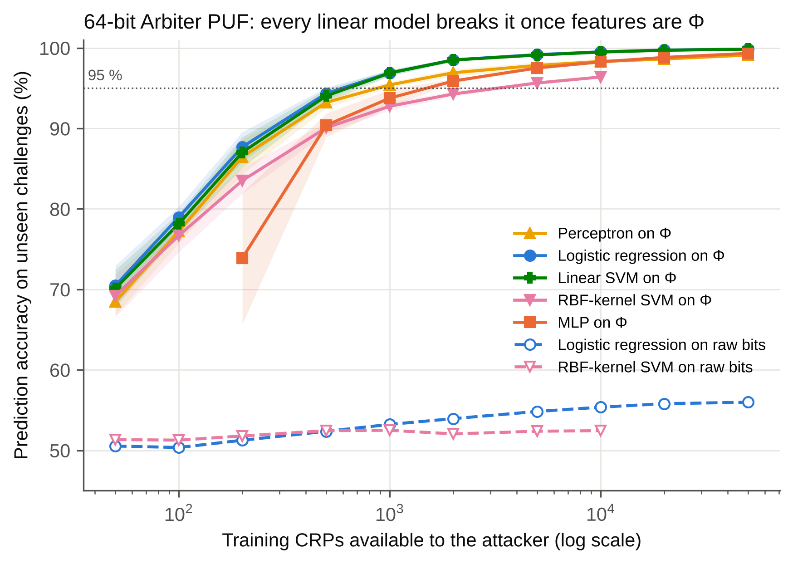
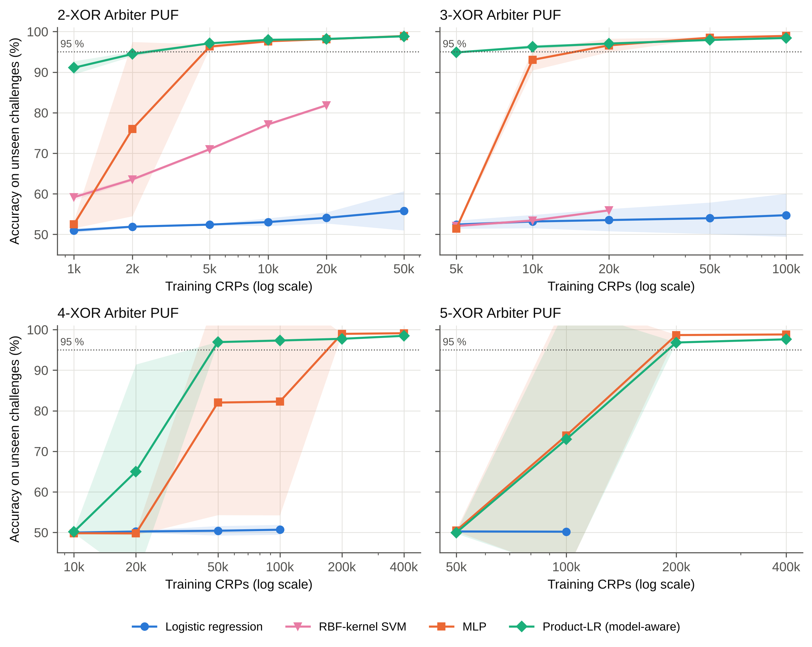

# ML modelling attacks on Arbiter and XOR Arbiter PUFs

How many challenge-response pairs (CRPs) does an attacker need to clone a PUF with machine learning? This repo simulates 64-bit Arbiter and k-XOR Arbiter PUFs (additive delay model) and compares a few classifiers on that task: perceptron, logistic regression, linear/RBF SVM, an MLP, and a product-model logistic regression (Product-LR).

Course project for MLEE (EEE G513) at BITS Pilani.

## Setup

```bash
python -m venv .venv
source .venv/bin/activate      # Windows: .venv\Scripts\activate
pip install -r requirements.txt
```

## Usage

```bash
python demo.py                      # clone a 64-bit arbiter PUF with LR
python demo.py --k 3 --crps 50000   # 3-XOR PUF with an MLP

python experiments/run_experiments.py --exp all --jobs 4
python experiments/make_figures.py
```

The full run takes roughly 15–30 minutes on a normal laptop CPU. You can run single experiments with e.g. `--exp e1,e3`.

## Layout

```
src/puf.py                    PUF simulator + parity feature transform
src/attacks.py                attack models
experiments/run_experiments.py
experiments/make_figures.py
demo.py
results/                      CSV output from the experiments
figures/                      plots
```

## Experiments

- **e0** PUF quality: uniformity, uniqueness, reliability
- **e1** 64-bit arbiter PUF: accuracy vs. number of CRPs, Φ features vs. raw bits
- **e2** CRPs needed vs. challenge length (16 to 256)
- **e3** XOR PUFs, k = 2 to 5
- **e4** evaluation noise
- **e5** whether LR recovers the actual delay parameters

Every model is tested on 20,000 fresh challenges and averaged over several simulated chips.

## Results

CRPs needed to reach 95% accuracy:

| Attack | Arbiter | 2-XOR | 3-XOR | 4-XOR | 5-XOR |
|---|---|---|---|---|---|
| Logistic regression (Φ) | 600 | fails | fails | fails | fails |
| MLP | 1,500 | 4,700 | 15,000 | 170,000 | 180,000 |
| Product-LR | same as LR | 2,400 | 5,400 | 47,000 | 190,000 |

- With the parity features Φ, a plain arbiter PUF is linearly separable and LR clones it with ~600 CRPs. On raw challenge bits, LR never gets above 56%.
- Linear models fail on XOR PUFs, but the MLP still gets 98.8% on a 5-XOR PUF with 400k CRPs.
- Each extra XOR only multiplies the number of CRPs needed by about 4–5x.
- Longer challenges add only ~9 CRPs per stage, and noise doesn't really stop the attack.




## Team

Paul Basu, Himanshu Deepak Gajare, David Mathew Vayaliparambil

All experiments use simulated PUFs only.
